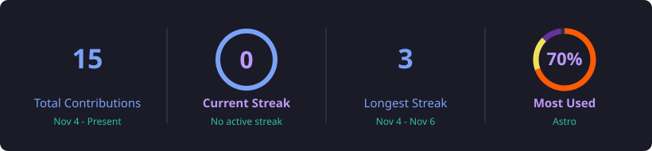

 

 

<!-- ABOUT -->

  <h2>About Me</h2>
  

    Informatics Engineering student focused on building clean, fast, 
    and easy to use web experiences.
  

<table align="center">
  <tr>
    <td><b>Field</b></td>
    <td>Informatics Engineering Student</td>
  </tr>
  <tr>
    <td><b>Focus</b></td>
    <td>Frontend Web Development, UI/UX Design, Video Editing</td>
  </tr>
  <tr>
    <td><b>Current Stack</b></td>
    <td>Astro, React, Tailwind CSS &amp; JavaScript</td>
  </tr>
  <tr>
    <td><b>Goal</b></td>
    <td>Building efficient, scalable, and user friendly web applications</td>
  </tr>
</table>

 

<!-- TECH STACK -->

  <h2>Tech Stack</h2>

  
<b>Languages</b>

  

    
    
    
    
    
    
    
    
    
  

  
<b>Frontend</b>

  

    
    
    
    
  

  
<b>Backend &amp; Databases</b>

  

    
    
    
    
  

  
<b>Design, Editing &amp; Game Dev</b>

  

    
    
    
    
  

  
<b>Tools</b>

  

    
    
    
  

 

<!-- STATS -->

  <h2>GitHub Statistics</h2>

  
   
  

 

<!-- SNAKE -->

  <h2>Contribution Snake</h2>
  

 

<!-- FOOTER -->

  
   
  <i>"Keep Building Something Better Every Day."</i>

